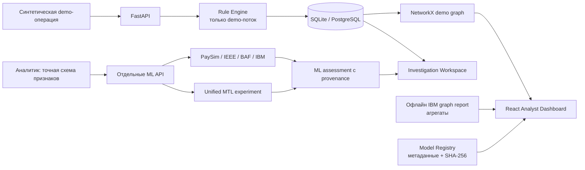
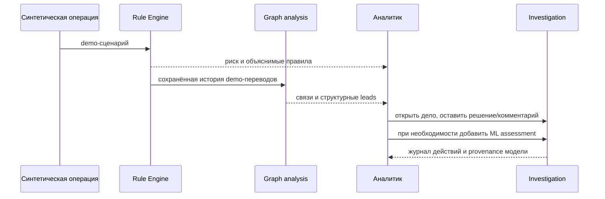

# IZQAR — Intelligent Fraud Prevention Platform

> **Исследовательская платформа для обнаружения и расследования финансового мошенничества.** IZQAR объединяет специализированные ML-детекторы, объяснимые поведенческие правила и графовый анализ связей, чтобы аналитик видел не только скор, но и его контекст. Это не замена банковскому ядру, а проверяемый MVP комплексного антифрод-подхода.


**Ключевая идея:** подозрительная операция — повод для расследования, а не автоматическое обвинение. IZQAR помогает собрать сигналы, показать связи и сохранить решение аналитика с понятным происхождением каждой оценки.

## Содержание

- [Проблема и решение](#проблема-и-решение)
- [Что работает сейчас](#что-работает-сейчас)
- [Модели и подтверждённые результаты](#модели-и-подтверждённые-результаты)
- [Архитектура](#архитектура)
- [Live Demonstration](#live-demonstration--how-izqar-works)
- [Быстрый запуск](#быстрый-запуск)
- [API и данные](#api-и-данные)
- [Ограничения и roadmap](#ограничения-и-roadmap)

## Проблема и решение

Одна внешне обычная операция может быть частью цепочки переводов, сети связанных счетов или новой схемы. При этом избыточные ложные тревоги перегружают аналитиков, а один числовой скор без объяснения редко достаточен для решения.

Современные банки уже используют ML и графовую аналитику. IZQAR исследует собственную интеграцию этих подходов: источники сигналов остаются разделёнными, их происхождение видно аналитику, а решение человека фиксируется в расследовании.

| Подсистема | Реальное назначение |
|---|---|
| **Transaction Intelligence** | Rule Engine оценивает только синтетические операции demo-симулятора и объясняет срабатывания. |
| **Multi-Model Fraud Detection** | Четыре отдельные XGBoost-модели для разных наборов данных и схем признаков. |
| **Unified Intelligence** | Экспериментальная multi-task сеть: четыре адаптера, общий обучаемый backbone и четыре task head. |
| **Financial Network Analysis** | Направленные связи, fan-in/out, быстрые цепочки и циклы как leads для расследования. |
| **Fraud Investigation** | Очередь дел, статусы, комментарии, журнал действий и server-side ML assessments. |

Rule Engine, ML-скор и графовый индикатор **не объединяются в вымышленную «вероятность мошенничества»**. Это разные источники информации с отдельными ограничениями.

## Что работает сейчас

- React + TypeScript консоль: Dashboard, операции, расследования, Network Explorer, ML Analytics и Model Registry.
- FastAPI с локальным demo API-key, строгими схемами, лимитом тела запроса 64 KiB и CORS только для localhost по умолчанию.
- Отдельный API-инференс для PaySim, IEEE-CIS, BAF Base, IBM AML и четырёх head Unified.
- Проверка схем, версий, происхождения и контрольных сумм артефактов; нет модели — нет фиктивного прогноза.
- Локальные TreeSHAP-вклады XGBoost для запроса модели: до пяти признаков без возврата введённых значений. Это объяснение модели, не причинный вывод.
- NetworkX/Cytoscape-граф демо-переводов. Если установлен отдельный IBM AML report, браузер получает только агрегаты без идентификаторов счетов.
- Локальный CPU-инференс и Kaggle Notebooks для ресурсоёмкого обучения без загрузки исходных CSV в Git.

## Модели и подтверждённые результаты

Каждая специализированная модель обучалась и оценивается **на своём** источнике. Поэтому сравнение строк таблицы не доказывает, что одна задача или модель «лучше» другой.

| Модель | Назначение и источник | Отложенный test | Precision | Recall | F1 | PR-AUC | ROC-AUC | FP / FN | Ложн. тревог / 10k |
|---|---|---:|---:|---:|---:|---:|---:|---:|---:|
| PaySim v2 | [синтетические переводы](https://www.kaggle.com/datasets/ealaxi/paysim1) | 955 744 | 0.898085 | 0.690025 | 0.780426 | 0.833058 | 0.998380 | 314 / 1 243 | 3.285 |
| IEEE-CIS v2 | [онлайн-платежи](https://www.kaggle.com/competitions/ieee-fraud-detection) | 88 581 | 0.526988 | 0.414856 | 0.464247 | 0.444182 | 0.875369 | 1 148 / 1 804 | 129.599 |
| BAF Base v1 | [синтетические заявки](https://github.com/feedzai/bank-account-fraud) | 96 843 | 0.288218 | 0.207283 | 0.241141 | 0.199692 | 0.891305 | 731 / 1 132 | 75.483 |
| IBM AML HI-Small v1 | [синтетические AML-операции](https://github.com/IBM/AML-Data) | 762 103 | 0.063125 | 0.667521 | 0.115342 | 0.101293 | 0.951370 | 15 465 / 519 | 202.925 |

Метрики взяты из установленных манифестов `backend/models/*.metrics.json`. Порог выбирался на validation, а не по итоговому test. Уже просмотренные test-наборы нельзя повторно использовать для подбора новой конфигурации.

### IZQAR Unified Intelligence — эксперимент, validation-only

Unified Intelligence — не router готовых моделей. Это одна PyTorch multi-task сеть с dataset-specific preprocessing/adapters, общим backbone и независимыми head для четырёх семантически разных задач. Gradient audit подтвердил ненулевой обучающий сигнал в shared layers от всех задач.

| Задача | Validation записей | F1 | PR-AUC | Статус |
|---|---:|---:|---:|---|
| PaySim | 75 000 | 0.050000 | 0.037139 | experimental |
| IEEE-CIS | 75 000 | 0.265172 | 0.188936 | experimental |
| BAF Base | 75 000 | 0.223346 | 0.137183 | experimental |
| IBM AML | 75 000 | 0.037538 | 0.013440 | experimental |

Это **не** финальная test-оценка и не доказательство превосходства над специализированными детекторами. Текущие результаты показывают, что совместное обучение само по себе не гарантирует улучшения; специализированные модели остаются основными рабочими детекторами. Методика и ограничения: [статус разработки](docs/DEVELOPMENT_STATUS.md).

## Архитектура



Демо-перевод не направляется автоматически во все ML-модели: их схемы несовместимы. Аналитик явно выбирает модель и передаёт точный контракт признаков; сервер пересчитывает оценку и сохраняет provenance, но не входные значения.

Подробнее: [архитектура](docs/ARCHITECTURE.md) · [аудит данных и моделей](docs/MULTIDATA_AUDIT.md) · [следующие шаги](docs/NEXT_STEPS.md).

## Live Demonstration — How IZQAR Works



1. Запустите сценарий: обычная операция, новый получатель, серия переводов, fan-in, цепочка или цикл.
2. Откройте запись: Rule Engine объясняет именно demo-оценку.
3. Перейдите к графу и изучите синтетические связи. Структурный сигнал не является доказательством мошенничества.
4. Откройте расследование, задайте статус и комментарий — запись сохранится в журнале.
5. В **ML Analytics** покажите реальные метрики и вызов каждой модели по её точной схеме.
6. При необходимости прикрепите к делу пересчитанную ML assessment. Она не меняет Rule Engine и решение аналитика автоматически.

Подробный пяти минутный сценарий: [docs/JURY_DEMO.md](docs/JURY_DEMO.md). Для каждого набора данных используйте отдельный запрос и не подставляйте фиктивный ответ модели.

## Скриншоты интерфейса

README намеренно не содержит декоративных или сгенерированных «скриншотов». Для жюри допустимы только снимки работающего приложения без API-ключей, приватных путей и выдуманных данных. Точные инструкции для Dashboard, мониторинга, ML Analytics, Registry, Graph, Investigation и Unified: [docs/screenshots/README.md](docs/screenshots/README.md).

## Быстрый запуск

> Текущая проверенная реализация находится в ветке `feat/ml-pipelines-and-startup`; `main` намеренно не изменялась. Для клона ветка должна быть опубликована в `origin` либо изменения должны быть приняты через PR.

```powershell
git clone https://github.com/Night011/izqar.git
cd izqar
git fetch origin
git checkout feat/ml-pipelines-and-startup
powershell -ExecutionPolicy Bypass -File .\scripts\start_local.ps1
```

Скрипт создаёт/проверяет локальную конфигурацию и ключ. Не вставляйте ключ в скриншоты, коммиты или чат. После готовности API:

```powershell
cd frontend
npm install
npm run dev
```

- React Dashboard: `http://127.0.0.1:5173`
- FastAPI health: `http://127.0.0.1:8000/health`
- API docs: `http://127.0.0.1:8000/docs`

Обучающие CSV и крупные артефакты не входят в Git. При отсутствии локального артефакта endpoint возвращает `503`, а не фиктивный прогноз. Инструкции по Kaggle, проверенному импорту артефактов и Unified final evaluation: [NEXT_STEPS](docs/NEXT_STEPS.md).

### Проверки

```powershell
cd backend
.\.venv\Scripts\python.exe -m pytest -q
cd ..\frontend
npm run build
```

Последняя локальная проверка: **52 backend tests passed**; React production build прошёл. Предупреждение Starlette TestClient о будущей deprecation известно и не скрывается.

## API и данные

| Метод | Путь | Назначение |
|---|---|---|
| `GET` | `/health` | Healthcheck без ключа |
| `POST` | `/api/v1/demo/simulate` | Синтетический сценарий Rule Engine |
| `GET` | `/api/v1/transactions`, `/api/v1/graph` | Demo-журнал и ограниченный граф |
| `GET` | `/api/v1/investigations` | Очередь и карточки расследований |
| `POST` | `/api/v1/investigations/{id}/ml-assessments` | Server-side ML assessment без сохранения feature values |
| `GET` | `/api/v1/model/status`, `/api/v1/model/registry` | Статус, реальные метрики, schema/provenance |
| `POST` | `/api/v1/{paysim\|ieee\|baf\|ibm-aml}/predict` | Отдельные специализированные ML-запросы |
| `POST` | `/api/v1/unified/{task}/predict` | Экспериментальная Unified head |
| `GET` | `/api/v1/graph/ibm-aml-report` | Агрегаты IBM graph report без ID счетов |

Все `/api/v1/*` вызовы требуют `X-API-Key`. Работайте только с доверенными локальными ML-артефактами: `joblib` исполняет Python-десериализацию, а JSON-манифест и SHA-256 не заменяют проверку происхождения.

## Данные, обучение и воспроизводимость

- Исходные датасеты остаются у поставщиков и в Kaggle; CSV, токены и реальные персональные данные в репозиторий не добавляются.
- PaySim: `isFraud` только y; исключены `isFlaggedFraud`, post-transaction balances, ID счетов и будущее. `step` — только время split.
- IEEE-CIS: transaction/identity merge по `TransactionID` с one-to-one проверкой; `TransactionDT` — время split, не ML-признак.
- BAF и IBM AML имеют собственные схемы и временные разбиения; их метки не считаются эквивалентными fraud-платежу.
- Imputation и encoding fit только на train; thresholds фиксируются по validation. Test не выбирает параметры.
- Ноутбуки: [PaySim](notebooks/paysim_kaggle.ipynb), [IEEE-CIS](notebooks/ieee_cis_kaggle.ipynb), [BAF](notebooks/baf_kaggle.ipynb), [IBM AML](notebooks/ibm_aml_kaggle.ipynb), [Unified](notebooks/unified_intelligence_kaggle.ipynb).

## Технологии

| Область | Используемый стек |
|---|---|
| Backend | Python, FastAPI, Pydantic, SQLAlchemy, SQLite / PostgreSQL |
| ML | XGBoost, scikit-learn, pandas, NumPy; PyTorch для Unified MTL |
| Frontend | React, TypeScript, Vite, Cytoscape.js |
| Graph | NetworkX, временные и структурные алгоритмы |
| Инфраструктура | Windows PowerShell startup, Docker Compose, GitHub Actions workflow |

## Ограничения и roadmap

### Ограничения

- IZQAR — research MVP, не production-ready банковская система.
- Большинство тренировочных источников синтетические; IEEE-CIS не доказывает качество на клиентах банка Казахстана.
- Высокая метрика PaySim не переносится автоматически на реальные банковские операции.
- IBM AML имеет высокий уровень ложных тревог на test; порог по test не перенастраивался.
- Unified — validation-only эксперимент; его скоры не откалиброваны как вероятности и она не заменила специализированные модели.
- Графовые сигналы — leads, а не доказательство мошенничества или отмывания.
- Один локальный API-key не является корпоративной аутентификацией, RBAC или неизменяемым аудитом.

### Roadmap

1. Улучшать Precision/Recall и стоимость ложных тревог на новых validation-периодах, не переиспользуя просмотренные test.
2. Добавить исторические поведенческие признаки, устойчивость к drift/неизвестным категориям и отдельную graph ML-модель.
3. Калибровать риски только на корректно выделенных данных.
4. Продолжить Unified MTL и выполнить одну sealed final evaluation зафиксированной конфигурации.
5. Добавить корпоративные роли, защищённый аудит, мониторинг и интеграции с разрешёнными банковскими потоками.

## Лицензии и данные

Исходный код распространяется по [MIT License](LICENSE). У каждого датасета есть собственные условия: соблюдайте правила Kaggle для IEEE-CIS, лицензию PaySim, BAF и IBM AML. В репозитории не должно быть CSV датасетов, Kaggle API-токенов, `.env`, непроверенных обучающих ZIP или реальных пользовательских данных.
